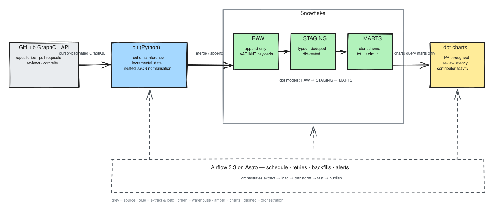
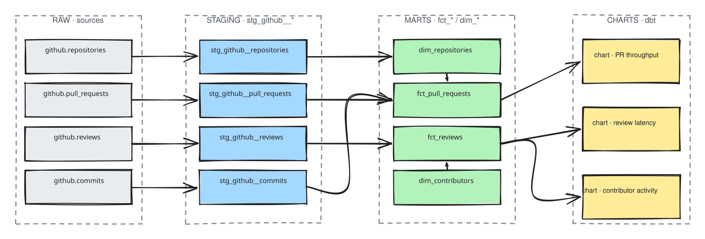

# GitHub Analytics Data Engineering Flow

From GitHub's GraphQL API to charts, in one auditable pipeline:
**GitHub GraphQL API → dlt → Snowflake → dbt → dbt charts**, orchestrated
end-to-end by **Airflow 3.3 on Astro**.

## What one run looks like

Airflow triggers the stages in order — each stage is a task in the DAG:

| # | Task | What it does |
|---|------|--------------|
| 1 | `extract_github` | dlt pulls new/changed records from the GitHub GraphQL API, cursor by cursor |
| 2 | `dbt run — staging` | dbt models transform RAW → STAGING (typed, deduped) |
| 3 | `dbt test — staging` | not_null / unique / relationships tests must pass before marts build |
| 4 | `dbt run — marts` | dbt models build `fct_*` / `dim_*` star-schema tables |
| 5 | `dbt test — marts` | mart-level tests + source freshness |
| 6 | `publish` | refresh dbt charts, notify on failure |

## Modelling with dbt

The warehouse is layered — RAW only ever receives data, dbt turns it into
models, and the charts query marts only:

The authoritative lineage is what dbt generates itself — `dbt docs generate &&
dbt docs serve` renders the same DAG straight from the project; the chart above
is its committed snapshot, so it renders for anyone reading the README.

## Why these choices

| Choice | Why | Alternatives rejected |
|--------|-----|----------------------|
| GitHub **GraphQL** API | One query traverses repo → PR → reviews → commits (REST is N+1, hundreds of calls per repo); point budget (5 000 pts/h) is predictable; cursor pagination + `updatedAt` filters make the pull incremental. | REST v3 (chatty), webhooks-only (no backfill, needs a listener). |
| **dlt** for ingestion | Declarative Python source: cursor pagination, incremental state, nested-JSON normalisation, schema inference + contracts, `merge`/`append` writers for Snowflake; runs in-process in the Airflow worker — nothing extra to deploy. | Hand-rolled `requests` + connector (re-implements pagination, state, upserts); Airbyte/Fivetran (heavy SaaS, per-row cost, less control); Singer taps (extra glue). |
| **Snowflake**, ELT not ETL | Land RAW as immutable `VARIANT` so every model is re-derivable — and auditable/replayable — **without hitting the API again** (the scarce resource). Zero-ops scaling, native JSON, per-second credit billing, mature dbt adapter. RAW/STAGING/MARTS schemas give least privilege (charts can only read MARTS) and cost control. | Postgres / DuckDB (no managed scale-out, weak VARIANT story at this volume); BigQuery (fine, but no hands-on muscle in the team). |
| **dbt** for transforms | SQL transformations are versioned in git with tests (`unique`, `not_null`, `relationships`, `freshness`), lineage docs, incremental models, per-target environments; KPI definitions live once in the mart layer instead of being copy-pasted per chart. | Python transforms (harder for analysts to review); Snowflake stored procs (no tests, no lineage). |
| **Charts in dbt**, not a separate BI tool | The presentation layer queries MARTS only, and the dbt lineage DAG is the one map everybody reads — definitions, lineage and tests in a single git-versioned project, so a chart can never drift from the model it claims to show; no second tool/licence/credential to maintain. Trade-off: less self-serve interactivity and no scheduled subscriptions — if stakeholders need ad-hoc exploration later, the marts are tool-ready for Metabase/Looker Studio without touching dlt or dbt. | A dedicated BI tool now (extra infra + licence before there is anything to show). |
| **Airflow on Astro** | One orchestrator for extract → transform → test → publish, with retries, alerting, backfills and a per-task UI; Astro gives local/prod parity (same runtime image in Docker via `astro dev start`) without operating a scheduler cluster; Python-first means dlt and dbt share one dependency graph. | cron + shell (no retries/UI/lineage); Snowflake tasks (SQL-only, awkward for a Python extractor); Dagster/Prefect (viable, but Airflow is the stack the team must know). |

## What exists today

| Layer | Status |
|-------|--------|
| Repo workflow + protected `main` | ✅ live |
| Airflow on Astro (orchestration) | ✅ live — `orchestration/` (ticket-003, in review) |
| dlt ingestion | ⏳ next ticket |
| dbt models | ⏳ planned |
| dbt charts | ⏳ planned |

The diagrams above are the **target** architecture — they describe where this
project is going, not only where it is. The "What exists today" table is the
source of truth for current state.

## Repository map

| Path | What lives there |
|------|------------------|
| `orchestration/` | Astro project: Airflow DAGs, Dockerfile, DAG-integrity tests (arriving with ticket-003) |
| `src/` | Python packages — the dlt ingestion source and shared pipeline code |
| `tests/` | `tests/unit` for logic, `tests/live` for acceptance criteria proven against real services |
| `docs/architecture/` | Excalidraw sources + rendered SVGs embedded in this README |
| `docs/tickets/` | One doc per ticket: plan + dated changelog, indexed below |

## Editing the diagrams

- The `.excalidraw` files are the **canonical** sources — open them on
  [excalidraw.com](https://excalidraw.com) or with the VS Code Excalidraw
  extension to edit.
- Re-export after editing (Menu → *Export image* → SVG, no background), save it
  next to the source, and commit **both** files. Details and the automated
  export path used by this ticket are in
  [docs/architecture/README.md](docs/architecture/README.md).

## How we work

- `main` is protected: changes land via pull request with **≥ 1 approval**,
  enforced by a GitHub
  [ruleset](https://github.com/ismail-ougamane/GitHub_Analytics_Data_Engineering_Flow/rules/26561116)
  plus classic branch protection — no custom code needed.
- Every ticket ships a `docs/tickets/TICKET-XXX-*.md` file containing its
  **plan** and a dated **changelog**.
- No secrets, ever: GitHub secret scanning and push protection are active.

See [CONTRIBUTING.md](CONTRIBUTING.md) for the review workflow, and
[docs/tickets/README.md](docs/tickets/README.md) for the ticket index.

## Branching & pull request workflow

**One phase = one feature branch = one pull request.** Each ticket gets its own
branch off `main` — `feat/ticket-XXX-slug` (or `fix`/`chore`/`docs`/`test`) —
and exactly one pull request.

**Pull requests start as drafts.** Open with `gh pr create --fill --draft`, flip
to ready with `gh pr ready`, and merge only after review (≥ 1 approval, enforced
by the ruleset). Squash-merge, then delete the branch.

**The 7-step loop:**

1. **Goal** — pick the ticket, write its acceptance criteria.
2. **Branch** — `git checkout -b feat/ticket-XXX-slug`
3. **Build** — smallest change that meets the criteria.
4. **Test** — prove the criteria, record the result.
5. **Document** — add a changelog entry to the ticket doc.
6. **PR** — open a draft PR, then mark it ready.
7. **Share** — request review, get 1 approval, squash-merge, delete branch.
